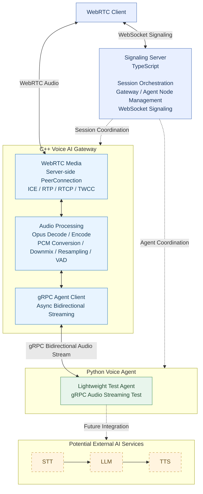

# Voice AI Gateway

**A C++ Based WebRTC Gateway for Real-Time Voice AI Communication**

## Project Overview

Voice AI Gateway is a real-time voice communication infrastructure that connects WebRTC clients with external Voice AI Agent systems.

It provides a WebRTC-based audio communication layer and bridges real-time audio streams to external agents through gRPC.

The project focuses on low-latency audio communication, media processing, and scalable integration architecture for Voice AI applications.

## Project Scope

This project focuses on building a real-time Voice AI Gateway that provides WebRTC-based media handling and integration with external voice agent services.

The primary responsibilities of the gateway include:

- WebRTC media ingress and egress
- RTP/RTCP handling and real-time media transport
- Audio processing, including decoding, downmixing, and resampling
- Bidirectional audio streaming between WebRTC clients and external agents
- Agent communication through gRPC-based streaming interfaces

### Agent Integration

The project includes a lightweight Python Test Agent to validate the gateway's audio streaming and communication architecture.

The Test Agent is intended for integration testing and does not implement actual STT, TTS, or LLM functionality.

The architecture is designed to support integration with external AI components, such as:

- Speech-to-Text (STT)
- Large Language Models (LLM)
- Text-to-Speech (TTS)

The implementation and operation of these AI engines are outside the scope of this project.

## Motivation

The project originally started with a personal goal: to build my own WebRTC SFU server.

Rather than building an SFU by combining existing open-source components such as libnice for ICE and implementing RTP packet handling separately, I wanted to take a different approach.

I chose Google's WebRTC Native Source as the foundation.

My idea was to reinterpret the original WebRTC implementation for server-side use: retain and adapt most of its core networking and media transport capabilities, remove components that were unnecessary for the server architecture, and add functionality required for server-side operation.

The goal was not simply to assemble existing WebRTC components, but to build a server-side WebRTC architecture based on the original WebRTC implementation itself.

This work eventually became the foundation for the Voice AI Gateway.

## Architecture

The gateway acts as an intermediary between WebRTC clients and external Voice AI Agents.

The architecture separates session orchestration from real-time media processing:

- **Signaling Server:** Handles session orchestration and coordinates Gateway and Agent nodes.
- **C++ Voice AI Gateway:** Manages WebRTC media transport, audio processing, and Agent communication.
- **Python Voice Agent:** Provides a lightweight test implementation for validating bidirectional audio streaming.
- **Potential AI Integration:** The architecture can be extended to integrate external STT, LLM, and TTS services.



*Solid lines represent implemented communication paths. Dashed lines indicate orchestration or potential future integration.*

### Main Communication Flow

1. A WebRTC client establishes a session through the signaling server.
2. The signaling server coordinates session assignment between available Gateway and Agent nodes.
3. The C++ Gateway establishes and manages the WebRTC media connection.
4. Incoming audio is decoded and converted into the required PCM format.
5. Audio frames are streamed bidirectionally between the Gateway and the Python Test Agent through gRPC.
6. The Test Agent validates the audio streaming interface and Gateway-Agent communication.

The architecture is designed to support future integration with external STT, LLM, and TTS services through the Agent layer. These AI components are not implemented in the current project.

## Core Components

### 1. WebRTC Media Layer (C++)

The WebRTC media layer is built around a server-side PeerConnection architecture based on Google's WebRTC Native Source.

Key areas include:

- Server-side PeerConnection
- ICE connectivity management
- RTP / RTCP handling
- Transport-Wide Congestion Control (TWCC)
- RTCP feedback handling
- Audio RTP reception and transmission

### 2. Audio Processing (C++)

The audio processing layer handles audio conversion between WebRTC media and Voice AI Agent requirements.

Key areas include:

- Opus audio decoding and encoding
- PCM audio processing
- Audio channel conversion and downmixing
- Audio resampling
- Voice Activity Detection (VAD)
- Audio buffering and frame management

### 3. Agent Communication (C++ / Python)

The Gateway communicates with external Voice AI Agents through a gRPC-based bidirectional streaming interface.

A lightweight Python Test Agent is included to validate audio streaming and Gateway-Agent communication.

Key areas include:

- C++ gRPC client
- Asynchronous bidirectional audio streaming
- CompletionQueue-based event processing
- Audio frame exchange between Gateway and Agent
- Python Test Agent integration
- Extensible interface for future Voice AI service integration

**Note:** The Python Agent is currently a test implementation. STT, LLM, and TTS processing are outside the scope of this project.

### 4. Signaling Server (TypeScript)

The signaling server handles session signaling and coordination between WebRTC clients and Gateway nodes.

It also manages Agent node information and coordinates the assignment of Gateway and Agent resources for each session.

Key areas include:

- WebSocket-based signaling
- Peer registration
- Gateway node management
- Agent node management
- Session coordination
- ICE signaling exchange

## Build & Installation

### Prerequisites

The project is primarily developed for Linux environments.

Expected development tools and dependencies include:

- Linux (Ubuntu)
- C++ compiler with C++17 support
- GN and Ninja build system
- CMake
- Python 3
- Node.js and npm (for the signaling server)
- gRPC and Protocol Buffers

Additional dependencies may be required depending on the build configuration.

### Build Instructions

This section describes how to prepare the development environment, build the project components, and run the Voice AI Gateway test environment.

The build process includes:

### 1. Native WebRTC Gateway

The native WebRTC Gateway is implemented in C++ and uses Google's WebRTC Native Source, modified for server-side PeerConnection functionality.

Navigate to the `gateway_core` directory:

```bash
cd gateway_core
```

Generate the Ninja build files using GN:

```bash
gn gen --args='...' out/debug
```

Build the Gateway:

```bash
ninja -C out/debug
```

After a successful build, the `RTCVoiceGatewayTestExecute` executable is generated in the build output directory.

### 2. C++ gRPC Agent Client

The C++ gRPC Agent Client provides asynchronous bidirectional audio streaming between the WebRTC Gateway and the Python Test Agent.

It is built as a shared library and integrated into the Gateway build.

The build process uses CMake and is invoked through the Gateway's GN build configuration.

The resulting shared library is:

```text
libgrpc_agent_client.so
```

Make sure the gRPC Agent Client is successfully built and available in the Gateway runtime library path.

### 3. Python Test Agent

The Python Test Agent is used to validate bidirectional audio streaming between the Gateway and an external Agent process.

Navigate to the `agent_server` directory:

```bash
cd agent_server

python3 -m venv venv
source venv/bin/activate
pip install grpcio grpcio-tools
python -m grpc_tools.protoc \
    -I../proto \
    --python_out=. \
    --grpc_python_out=. \
    ../proto/voice_agent.proto
```

Activate the Python virtual environment:

```bash
source venv/bin/activate
```

The Agent can then be started using:

```bash
python voice_agent_server.py
```

By default, the Test Agent listens on the local IP address at port `50051`.

The Agent connects to the Signaling Server through WebSocket. Use `--signaling-url` to specify the Signaling Server address:

```bash
python voice_agent_server.py --signaling-url ws://192.168.0.100:8080/agent
```

The default Signaling Server endpoint is:

```text
ws://<local-ip>:8080/agent
```

### 4. Signaling Server

The Signaling Server is implemented in TypeScript and is responsible for session orchestration and coordination between Gateway and Agent nodes.

Navigate to the `signaling_server` directory:

```bash
cd signaling_server
```

Install the Node.js dependencies:

```bash
npm install
```

Compile the TypeScript source:

```bash
npx tsc
```

Start the Signaling Server:

```bash
npm run dev
```

By default, the Signaling Server listens on the local IP address at port `8080`.

### 5. WebRTC Gateway Runtime Configuration

After building the Gateway, navigate to the directory containing the `RTCVoiceGatewayTestExecute` executable.

By default, the Gateway connects to the Signaling Server at the local IP address on port `8080`.

To connect to a Signaling Server at a specific IP address and port, use the following options:

```bash
./RTCVoiceGatewayTestExecute --ip 192.168.0.100 --port 8080
```

- `--ip`: Signaling Server IP address.
- `--port`: Signaling Server port.

## Running the System

Start the components in the following order:

### 1. Start the Signaling Server

```bash
cd signaling_server
npm run
```

The Signaling Server listens on the local IP address at port `8080` by default.

### 2. Start the Python Test Agent

```bash
cd agent_server
source venv/bin/activate
python py
```

The Test Agent listens on the local IP address at port `50051` by default and registers with the Signaling Server.

To use a different Signaling Server endpoint:

```bash
python py --signaling-url ws://192.168.0.100:8080/agent
```

### 3. Start the WebRTC Gateway

Navigate to the directory containing the Gateway executable:

```bash
cd gateway_core/out/debug
./RTCVoiceGatewayTestExecute
```

The Gateway connects to the local Signaling Server at port `8080` by default.

To specify a different Signaling Server address:

```bash
./RTCVoiceGatewayTestExecute --ip 192.168.0.100 --port 8080
```

### 4. Connect a WebRTC Client

Start the WebRTC Client and connect it to the Signaling Server to establish a WebRTC session through the Gateway.

Once connected, the Gateway receives WebRTC audio and forwards it to the Python Test Agent through the gRPC bidirectional audio streaming interface.

The Python Test Agent returns audio through the same gRPC stream, allowing the Gateway-Agent audio communication path to be validated.

---

## Notes

- The Signaling Server, Python Test Agent, and WebRTC Gateway are separate processes.
- The Signaling Server coordinates Gateway and Agent registration and session orchestration.
- The Python Test Agent is a lightweight test implementation for validating audio streaming. It does not implement STT, TTS, or LLM functionality.
- The Gateway and Agent communicate through gRPC bidirectional streaming.
- The default ports are `8080` for the Signaling Server and `50051` for the Python Test Agent.

### Configuration

Runtime configuration should be provided separately from source code.

Do not commit API keys, credentials, or environment-specific configuration files to the repository.

Refer to the example configuration files when available.

## Project Status

Voice AI Gateway is an actively developed project.

| Component | Status |
|---|---|
| WebRTC Gateway | Implemented |
| Server-side PeerConnection | Implemented |
| ICE / RTP / RTCP handling | Implemented |
| Audio Processing Pipeline | Implemented |
| C++ gRPC Agent Client | Implemented |
| Python Test Agent Integration | Implemented |
| TypeScript Signaling Server | Implemented |
| Performance Benchmarking | Ongoing |
| Production Deployment Validation | Not yet validated |

The project is intended to demonstrate the design and implementation of a real-time WebRTC-based Voice AI infrastructure.

## Known Limitations

### Stability
- An intermittent runtime crash has been observed.
- The root cause is currently under investigation.
- Further testing and debugging are ongoing to improve stability.

### Performance Evaluation

- Development and performance testing have been conducted in an Ubuntu VM running on a Windows laptop using VirtualBox.
- Due to the limitations and overhead of the virtualized environment, performance measurements may not accurately represent the system's actual performance.
- The current benchmark results should be considered preliminary and are provided for reference only.
- Reliable performance evaluation requires testing on dedicated hardware under controlled conditions.

## Roadmap

- Improve Gateway scalability and resource management.
- Improve real-time audio streaming performance.
- Expand monitoring and performance metrics.
- Improve deployment and build documentation.
- Extend Voice AI Agent integration.
- Explore integration with external STT, LLM, and TTS services.

## Contribution

Contributions, bug reports, and technical discussions are welcome.
Feel free to open an issue or submit a pull request.

## Contact

Email: jacques97jj@gmail.com

[LinkedIn](https://linkedin.com/in/joongje-jang)

## License

This project is licensed under the Apache License 2.0.

See the [LICENSE](LICENSE) file for details.

Third-party components and dependencies retain their respective licenses and copyright notices. Refer to `THIRD_PARTY_NOTICES.md` for applicable third-party license information.

## Acknowledgements

This project builds upon the open-source WebRTC ecosystem.

Special thanks to the developers and communities maintaining the open-source projects and libraries used by this project.