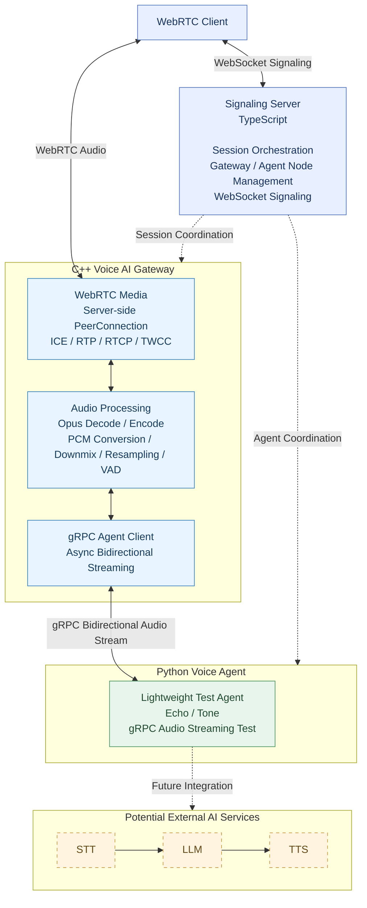

# aone_voice_ai_gateway

A WebRTC gateway for real-time voice AI agents, built on a server-oriented PeerConnection derived from Google libwebrtc.

Browser audio arrives over WebRTC (Opus), is decoded and resampled by the Gateway, and is streamed to an external Voice AI Agent over gRPC. The Agent's PCM reply is buffered, Opus-encoded on a 20 ms tick, and sent back to the browser as RTP.

> **Status: prototype / pre-alpha.**  
> This project works in the author's test setup (Ubuntu VM, Chrome, echo/tone test agent). It is not production-ready.  
> It has no authentication, uses plaintext WebSocket and insecure gRPC, and must not be exposed to the public Internet.

## Architecture



*Solid lines represent implemented communication paths. Dashed lines indicate orchestration or potential future integration.*

## What It Does

- WebRTC audio ingress and egress
- ICE, RTP, RTCP, and Transport-Wide Congestion Control (TWCC) handling
- Opus decoding and encoding
- PCM conversion, channel conversion, downmixing, and resampling
- Optional Voice Activity Detection (VAD)
- Bidirectional PCM audio streaming to an external Agent over gRPC
- WebSocket signaling and Gateway/Agent registration
- Echo/tone Python test Agent for integration testing

The included Python Test Agent validates the Gateway-Agent audio path. It does **not** implement STT, LLM, or TTS functionality.

## Main Communication Flow

1. A WebRTC client establishes a session through the signaling server.
2. The signaling server coordinates session assignment between available Gateway and Agent nodes.
3. The C++ Gateway establishes and manages the WebRTC media connection.
4. Incoming Opus audio is decoded and converted into the required PCM format.
5. Audio frames are streamed bidirectionally between the Gateway and the Python Test Agent through gRPC.
6. The Test Agent returns audio through the same gRPC stream.
7. The Gateway buffers, Opus-encodes, and transmits the returned audio back to the browser as RTP.

## Project Scope

This project focuses on the real-time media and integration layer for Voice AI applications:

- WebRTC-based media transport
- Server-side PeerConnection architecture
- Audio decoding, encoding, and format conversion
- Gateway-to-Agent gRPC streaming
- Signaling and node orchestration

The implementation and operation of external AI engines are outside the scope of this project. The architecture is designed so that future STT, LLM, and TTS services can be integrated through the Agent layer.

## Core Components

### WebRTC Media Layer

The WebRTC media layer is built around a server-side PeerConnection architecture based on Google's WebRTC Native Source.

Key areas include:

- Server-side PeerConnection
- ICE connectivity management
- RTP / RTCP handling
- Transport-Wide Congestion Control (TWCC)
- RTCP feedback handling
- Audio RTP reception and transmission

### Audio Processing

The audio processing layer converts audio between WebRTC media and Voice AI Agent requirements.

Key areas include:

- Opus audio decoding and encoding
- PCM audio processing
- Audio channel conversion and downmixing
- Audio resampling
- Voice Activity Detection (VAD)
- Audio buffering and frame management

### Agent Communication

The Gateway communicates with external Voice AI Agents through a gRPC-based bidirectional streaming interface.

Key areas include:

- C++ gRPC client
- Asynchronous bidirectional audio streaming
- CompletionQueue-based event processing
- Audio frame exchange between Gateway and Agent
- Python Test Agent integration
- Extensible interface for future Voice AI service integration

### Signaling Server

The TypeScript signaling server handles session signaling and coordination between WebRTC clients, Gateway nodes, and Agent nodes.

Key areas include:

- WebSocket-based signaling
- Peer registration
- Gateway node management
- Agent node management
- Session coordination
- ICE signaling exchange

## Status

| Area | State |
|---|---|
| WebSocket signaling server (`/peer`, `/node`, `/agent` roles) | Working |
| WebRTC audio ingress: Opus decode, channel conversion, resampling | Working |
| gRPC agent client: async CompletionQueue client, channel/stream lifecycle | Working in the author's tests; lifecycle code has not been validated with TSAN/ASAN |
| Egress: PCM ring buffer, 20 ms tick, Opus encode, RTP output | Working |
| Python test agent: echo / tone, signaling registration | Working |
| VAD gating of ingress audio | Optional; compile-time flag `__ENABLE_VAD__`, disabled by default |
| Barge-in / interruption / clear protocol | Not implemented; designed only, and the proto has no control messages yet |
| TLS / authentication | Not implemented |
| Real STT / LLM / TTS agent | Not included; only echo and tone test agents are provided |
| Multi-node scale-out | Not implemented |
| Performance and capacity benchmarks | Not published; measurements so far come from a 2-vCPU VM only |
| Production deployment validation | Not validated |

## Repository Layout

```text
proto/                         gRPC service definition shared by the Gateway and Agents
signaling_server/              Node.js / TypeScript WebSocket signaling server (port 8080)
agent_server/                  Python test agent (echo / tone) that registers itself with the signaling server
client/browser/                Browser pages (index2.html: sender, rtc_node.html: Chrome baseline node)
gateway_core/                  C++ Gateway (GN / Ninja)
  RTCPeerConnection/           server-side peerconnection
  RTCVoiceGateway/             Gateway server and 20 ms audio tick scheduler
  RTCAgentBridge/              Ingress/egress bridge between WebRTC audio and the Agent
  GRPCAgentClient/             gRPC client for the Agent; built with CMake and driven by a GN action
  RTCClient/                   WebRTC client wrappers
  RTCCodec/                    Opus codec integration
  RTCAudioUtils/               Audio utilities
  RTCSignalingSession/         Signaling session handling
  RTCUtils/                    General utilities
  RTCVad/                      Voice Activity Detection (optional)
  ALog/                        Logging, derived from AOSP liblog
  RTCVoiceGatewayTestExec/     Test executable
```

## RTCPeerConnection

`gateway_core/RTCPeerConnection` is a server-oriented modification of Google's libwebrtc. It includes custom Pacer, RTCP handling, simulcast routing, and thread/resource architecture changes.

It is not included in this repository because of its size.

Add it as a Git submodule at `gateway_core/RTCPeerConnection`, or clone it there.

```text
Source: <URL of the RTCPeerConnection repository>
```

Build it so that its libraries are placed in the same GN output directory as this project, for example `out/debug`. See that repository's README for its build steps.

### Provenance

The sources were merged from different WebRTC revisions from the 2020 and 2023 era. Therefore, there is no single upstream base commit.

A file-level provenance document is planned.

The WebRTC license (BSD 3-Clause) and patent grant apply to that code.

## Requirements

- Linux; developed on Ubuntu
- Clang
- C++17-compatible compiler
- GN and Ninja
- CMake 3.15 or later
- pkg-config
- gRPC (`grpc++`)
- Protocol Buffers
- Opus
- libwebsockets
- Jansson
- OpenSSL
- Node.js 20 or later
- Python 3 with `grpcio`, `grpcio-tools`, and `websockets`

### Ubuntu Example

Package names may differ by Ubuntu release.

```bash
sudo apt install clang cmake ninja-build pkg-config libopus-dev libwebsockets-dev \
  libjansson-dev libssl-dev libgrpc++-dev libprotobuf-dev protobuf-compiler-grpc

pip install grpcio grpcio-tools websockets
```

## Build

### Native WebRTC Gateway

```bash
cd gateway_core
gn gen out/debug
ninja -C out/debug
```

For a release build:

```bash
gn gen out/release --args='is_debug=false'
ninja -C out/release
```

The Gateway test executable is generated as:

```text
gateway_core/out/debug/RTCVoiceGatewayTestExecute
```

`GRPCAgentClient` is built with CMake. A GN action invokes it as part of the Ninja build, producing:

```text
libgrpc_agent_client.so
```

The shared library is placed alongside the other build outputs. Do not use a debug build for timing measurements: debug builds are compiled without optimization, and the audio tick cost is dominated by that.

## Run

Start the components in separate terminals.

### 1. Start the Signaling Server

```bash
cd signaling_server
npm install
npm run dev
```

The signaling server listens on `0.0.0.0:8080` by default.

### 2. Start the Python Test Agent

Generate the protobuf code once:

```bash
cd agent_server
python3 -m grpc_tools.protoc \
  -I ../proto \
  --python_out=. \
  --grpc_python_out=. \
  ../proto/voice_agent.proto
```

Start the Agent:

```bash
python3 voice_agent_server.py --port 50051 --mode echo
```

By default, the Agent listens on `0.0.0.0:50051` and registers with the signaling server.

To use a different signaling server endpoint:

```bash
python3 voice_agent_server.py \
  --signaling-url ws://192.168.0.100:8080/agent
```

To run only the gRPC server without registering with the signaling server:

```bash
python3 voice_agent_server.py --no-signaling
```

### 3. Start the WebRTC Gateway

```bash
cd gateway_core
./out/debug/RTCVoiceGatewayTestExecute
```

When the executable starts, type `s` to start and `e` to stop.

By default, the Gateway connects to the signaling server on the local machine at port `8080`.

To specify a different signaling server address:

```bash
./out/debug/RTCVoiceGatewayTestExecute --ip 192.168.0.100 --port 8080
```

### 4. Open the Browser Client

Serve the browser page:

```bash
python3 -m http.server -d client/browser 8000
```

Open:

```text
http://localhost:8000/index.html
```

Enter the signaling server address in the **Server** field:

```text
<signaling-server-ip>:8080
```

Microphone access requires `localhost` or HTTPS.

## Defaults

| Component | Option | Default |
|---|---|---|
| Signaling server | Port | `8080` (constant in `signaling_server/src/main.ts`) |
| Gateway test executable | `--ip`, `-i` | This machine's IP address |
| Gateway test executable | `--port`, `-p` | `8080` |
| Test Agent | `--signaling-url` | `ws://<this-machine-ip>:8080/agent` |
| Test Agent | `--no-signaling` | Off |
| Test Agent | `--port` | `50051` |
| Test Agent | `--host` | `0.0.0.0` |
| Test Agent | `--mode` | `echo` |

The machine IP is the address of the default-route interface. On a machine with multiple interfaces, VPNs, or Docker networks, pass the address explicitly.

```bash
./out/debug/RTCVoiceGatewayTestExecute --ip 192.168.0.10 --port 8080
python3 voice_agent_server.py --signaling-url ws://192.168.0.10:8080/agent
```

## Interfaces

### Signaling

The signaling server uses JSON messages over WebSocket.

Roles are separated by path:

- `/peer`: browser client
- `/node`: Gateway or Chrome baseline node
- `/agent`: Agent registration

Agent registration uses a message such as:

```json
{
  "cmd": "regist",
  "endpoint": "host:port"
}
```

### Agent Protocol

`proto/voice_agent.proto` defines:

- `GetAudioFormats`: audio format handshake
- `AudioStream`: bidirectional raw PCM S16LE audio frames

The test Agent uses:

- 16 kHz mono PCM
- 20 ms frames

## Security Notes

> **This project is intended for local development and trusted-network testing only.**  
> Do not expose the signaling server, Gateway, Agent, or browser client to the public Internet in its current form.

### Current Security Posture

| Area | Current State | Risk |
|---|---|---|
| Signaling transport | Plain `ws://` WebSocket | Signaling messages, SDP, and ICE candidates can be observed or tampered with on the network. |
| Signaling authentication | None | Any reachable client can connect as a peer, register as a Gateway, or register an Agent. |
| Agent registration | Unauthenticated | Any client that can reach the signaling server can submit an Agent endpoint; the Gateway may then open a gRPC connection to that address. |
| Gateway-to-Agent gRPC | Insecure channel; no TLS or mTLS | Audio PCM and control messages can be intercepted, modified, or impersonated. |
| Server binding | Components may bind to `0.0.0.0` | Services are reachable from every network interface unless explicitly restricted. |
| Browser client | Served over plain HTTP in the documented test flow | Browser microphone access requires `localhost` or HTTPS; non-local HTTP usage is not a secure deployment model. |
| ICE configuration | Public Google STUN server is provided by default | Client public IP addresses may be exposed to a third-party STUN service. |
| TURN | Not included | NAT traversal may fail in restrictive networks. TURN, when added, must use authenticated and preferably short-lived credentials. |

### Why This Matters

WebRTC media streams are protected with DTLS-SRTP, but that does not make the complete application secure by itself.

The signaling channel, user authorization, ICE/TURN configuration, server configuration, and media processing performed outside the browser-to-browser encrypted path remain the operator's responsibility.

In this project, the Gateway receives decoded PCM audio and forwards it to an Agent over gRPC. Therefore, the Gateway and Agent must be treated as trusted media-processing components: once audio reaches the Gateway, end-to-end browser encryption does not protect the Gateway-to-Agent communication path.

### Required Controls Before Shared Deployment

Before deploying beyond a single developer machine or a fully trusted LAN, implement at least the following:

- Serve the signaling server and browser client over HTTPS and use `wss://` rather than `ws://`.
- Authenticate WebSocket connections and authorize each signaling action, including peer registration, Gateway registration, Agent registration, and session creation.
- Restrict Agent registration to authenticated, trusted Gateway or operator identities. Do not allow arbitrary clients to submit arbitrary `host:port` endpoints.
- Enable TLS for Gateway-to-Agent gRPC. For service-to-service communication, prefer mutual TLS (mTLS) with short-lived certificates and automated rotation.
- Bind services to specific internal interfaces where possible. Use firewall rules or security groups to allow only required source networks and ports.
- Replace the default public STUN endpoint with your own STUN/TURN configuration when privacy or network policy requires it.
- If TURN is introduced, use authenticated, short-lived credentials issued by the application server rather than static shared credentials.
- Do not commit API keys, TURN credentials, certificates, or environment-specific configuration files to the repository. Load them from environment variables, secret managers, or deployment-specific configuration files.
- Add request and session rate limiting, logging, and alerting before exposing the system to multiple users.

### Recommended Production Baseline

For a production-oriented deployment, the minimum target should be:

- `https://` for the browser client and `wss://` for signaling.
- Authenticated and role-aware signaling: browser, Gateway, and Agent roles must not share an unauthenticated registration path.
- TLS or mTLS for all Gateway-to-Agent gRPC traffic.
- A private or authenticated STUN/TURN deployment, with TURN credentials that expire.
- Network isolation between the Gateway, Agent, signaling server, and any future STT/LLM/TTS service.
- No direct public exposure of the Gateway's WebRTC media ports, Agent gRPC port, or internal service ports.

## Known Limitations

### Stability

- An intermittent runtime crash has been observed during testing.
- The root cause has not yet been identified.
- The Gateway lifecycle, gRPC client lifecycle, audio scheduler, and media-path error handling have not yet been validated with sanitizers such as ASan or TSan.
- Unexpected peer disconnects, Agent failures, malformed signaling messages, and mid-session gRPC stream failures may not yet be handled cleanly.

### Concurrency and Performance

- The 20 ms egress audio tick does not remain stable with approximately 16 concurrent peers in the author's 2-vCPU VM test environment.
- The current tick scheduler uses a fixed number of worker threads and does not yet adapt to load or peer count.
- No published latency, CPU, memory, packet-loss, jitter, or capacity benchmarks are available.
- Existing measurements were collected in a VirtualBox VM and should be treated as preliminary. They do not establish production capacity or real-hardware performance.
- Debug instrumentation, including PCM file dumps and timing helpers, may still be present in some source files.

### Protocol and Feature Gaps

- Barge-in, interruption, and agent-output clearing are designed conceptually but are not implemented.
- The current `voice_agent.proto` defines audio format negotiation and bidirectional raw PCM streaming, but does not yet define control messages for interruption, cancellation, session state, or error reporting.
- The included Python Agent is an echo/tone test agent only. It does not implement STT, LLM, TTS, or any production voice-AI workflow.
- Multi-node scale-out, Gateway/Agent failover, session recovery, and horizontal scaling are not implemented.
- There is no production deployment validation, operational runbook, monitoring integration, or capacity-planning guidance yet.

### Compatibility and Provenance

- The project has been tested primarily with Chrome and an Ubuntu VM. Browser, OS, network, and codec compatibility have not been broadly validated.
- `gateway_core/RTCPeerConnection` is a modified, server-oriented variant of Google libwebrtc and is not included directly in this repository.
- Its sources were merged from WebRTC revisions from different periods, so there is no single upstream base commit.
- A file-level provenance document is planned but not yet available.
- WebRTC-related code remains subject to the WebRTC BSD 3-Clause license and patent grant. Third-party dependencies retain their own licenses.

## Roadmap

- Improve Gateway scalability and resource management.
- Improve real-time audio streaming performance.
- Implement barge-in, interruption, and Agent output clearing.
- Add TLS, authentication, and authorization for signaling and gRPC.
- Add monitoring, metrics, tracing, and alerting.
- Improve deployment, build, and operations documentation.
- Extend Voice AI Agent integration.
- Explore integration with external STT, LLM, and TTS services.
- Validate performance on dedicated hardware under controlled conditions.

## Configuration

Runtime configuration should be provided separately from source code.

Do not commit API keys, credentials, certificates, TURN credentials, or environment-specific configuration files to the repository.

Refer to example configuration files when available.

## AI Assistance

Parts of this repository were drafted with AI assistance and then reviewed and tested by the author.

AI-assisted areas include:

- The gRPC Agent client layer
- The egress ring buffer
- The audio tick scheduler
- The Python test Agent
- Build scripts

## Contributing

Contributions, bug reports, and technical discussions are welcome.

Feel free to open an issue or submit a pull request.

## Contact

Email: [jacques97jj@gmail.com](mailto:jacques97jj@gmail.com)

[LinkedIn](https://linkedin.com/in/joongje-jang)

## License

This project is licensed under the Apache License 2.0.

See [LICENSE](LICENSE) for details.

Third-party components and dependencies retain their respective licenses and copyright notices. Refer to  [THIRD_PARTY_NOTICES.md](THIRD_PARTY_NOTICES.md) for applicable third-party license information.

## Acknowledgements

This project builds upon the open-source WebRTC ecosystem.

Special thanks to the developers and communities maintaining the open-source projects and libraries used by this project.
